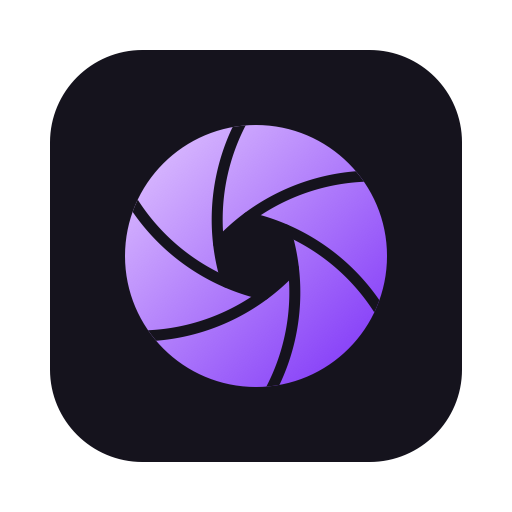

<p align="center">
  
</p>

<h1 align="center">Jilo Studio</h1>

<p align="center">
  <b>An AI-first video editor for the Mac, written in Rust.</b><br>
  Editing by text and by request, short video for social media and professional tools at hand: made for macOS, at home in Russian, Tajik and English.
</p>

<p align="center">
  <a href="#license-and-credits"></a>
  
  
</p>

<p align="center">
  <a href="https://rustamguloff.com/en/page/projects/jilo-studio"><b>Website</b></a> ·
  <a href="https://github.com/guloff/jilo-studio/releases/latest"><b>Download</b></a> ·
  <a href="https://github.com/guloff/jilo-studio/issues">Issues</a> ·
  <a href="https://rustamguloff.com/ru/page/projects/jilo-studio">По-русски</a>
</p>

## What it is

Jilo Studio is a Mac video editor where AI comes first and everyday edits take a click. You talk
to it, cut by deleting words from the transcript, and get captions, shorts and a platform-ready mix
in a few steps; underneath is a full non-linear editor in pure Rust, with trimming, multicam, colour,
keyframes, effects, titles, its own codecs and export. Every edit is a command, so the same project
can be driven by you, a script or an AI assistant (MCP).

**Download**: the signed and notarized app from
[Releases](https://github.com/guloff/jilo-studio/releases/latest) (Apple silicon, macOS 15 Sequoia
or later). From 0.6.4 on it updates itself (Help ▸ Check for Updates).

**Windows 10 and 11 (x64)**: `jilo-studio-<version>-windows-x64-setup.exe` installs for your user
account without administrator rights (Start menu, `.jsproj` files open with it, Settings ▸ Apps
removes it); the portable zip runs from any folder and keeps its data next to it. The Windows build
is not code-signed yet, so SmartScreen asks once (More info ▸ Run anyway). On Windows, Whisper and
the Kokoro voices run on the CPU, faces come from Windows's own face detector, hardware decoding is
Media Foundation (DXVA) and hardware encoding NVENC on NVIDIA cards; the Apple Vision features
(background removal, cut-out stickers, scene labels for B-roll) and emoji stickers are macOS-only for now.

## What it does

- **AI first**: one AI menu and an AI panel. Speech recognition in Russian, Tajik and English with
  the time of every word (on the Mac or in the cloud); edit by text; remove pauses, filler words,
  retakes and stumbles; cut a recording into vertical shorts; make a sequence vertical following
  the speaker's face; auto multicam by who speaks; auto B-roll; remove the background of a video;
  translate and dub captions; highlights, automatic zooms, YouTube titles, chapters and thumbnail;
  an assistant that turns a request into steps. Every AI step is one undo.
- **Simple editing**: start by dropping a video on the home screen; Simple mode and the AI Editing
  workspace; a command palette (⌘J); quick actions under the picture (split, a speed menu, freeze
  frame, reframe); the Library panel, with a transition on every cut or a look on every clip in one
  click; a CapCut Compatible keyboard preset; tips.
- **Captions and graphics for social media**: 45 caption looks and your own, karaoke highlighting,
  fonts with Tajik letters, captions dragged anywhere in the picture, one phrase styled alone; 24
  title templates; a brand kit and project templates; stickers (emoji, shapes, cut out of your clips
  or drawn from a description, attached to a face).
- **Sound and export**: auto mix to a platform's loudness, cuts on the beat, a sound library made by
  the app (CC0); every format at once (16:9, 9:16, 1:1, 4:5) and presets for TikTok, Reels,
  Shorts, Instagram, YouTube, Telegram and X.
- **Automation**: recipes, batch processing with an inbox folder, Finder Quick Actions,
  notifications when long work ends.
- **The Mac way**: VideoToolbox decoding and encoding (H.264, HEVC Main 10, hardware ProRes),
  Whisper and Kokoro on Metal, Apple Vision, projects and media from Finder and the Dock, HDR (EDR)
  on XDR displays, updates from inside the app, a Russian interface.
- **Stability**: crash and data-loss fixes, framework symbols checked against the deployment target,
  a smoke test of every build.

## AI and your privacy

- **Local first.** Speech recognition (Whisper), the natural voices (Kokoro), face finding, image
  labels and background removal (Apple Vision) run on your Mac. Settings ▸ AI ▸ **Only on this
  computer** turns every cloud engine off.
- **Cloud only when you ask.** Google Gemini, OpenAI, Anthropic Claude and ElevenLabs are optional
  engines (Settings ▸ AI). Audio, text or an image description goes to one only when you run a
  feature with it, and the app asks before the first time; the consents can be taken back.
- **Your keys stay yours.** API keys live in
  `~/Library/Application Support/com.rustamguloff.jilostudio/ai.json`, readable only by your user
  account (or come from environment variables), never in projects or logs.
- **No telemetry.** Besides the AI providers you choose, the app goes online only to check GitHub
  for a new release once a day (Settings ▸ General can turn it off) and to download what you ask
  for: speech models and voices (Hugging Face), caption fonts (Google Fonts) and updates (GitHub),
  each checked by SHA-256.

## Build from source

```sh
cargo run --release -p jilo-studio                      # the app
cargo run --release -p jilo-studio -- --control 9876    # plus the JSON-lines control server
cargo run --release -p jilo-cli -- mcp                  # MCP server (headless)
bash packaging/macos/package.sh                         # Jilo Studio.app and the DMG (ad-hoc signed)
```

On Windows, with Rust for `x86_64-pc-windows-gnu`, MinGW-w64 GCC on `PATH`
(`winget install BrechtSanders.WinLibs.POSIX.MSVCRT`) and Inno Setup 6
(`winget install JRSoftware.InnoSetup`):

```powershell
powershell -ExecutionPolicy Bypass -File packaging/windows/package.ps1   # installer and portable zip in dist/release
```

The rules and quality gates: [docs/rules.md](docs/rules.md) and
[docs/contributing.md](docs/contributing.md); the architecture is in
[docs/architecture.md](docs/architecture.md), automation (MCP, control channel, CLI) in
[docs/automation.md](docs/automation.md).

## Origins

Jilo Studio began in October 2026 as a fork of [FilmCraft](https://github.com/storytold/filmcraft)
by the ArtCraft team, a clean-room Rust reimplementation of the Premiere Pro workflow, and is
developed as a project of its own: its own plan, version numbers (0.6.0 was the first release),
crate names and project format (`.jsproj`; projects saved as `.fcproj` still open). How the two
differ, in Russian: [docs/upstream.md](docs/upstream.md).
Jilo Studio is not made, sponsored or endorsed by the ArtCraft team, and its builds do not carry
the ArtCraft marks (their terms: [docs/brand/LICENSE-brand.txt](docs/brand/LICENSE-brand.txt)).

## License and credits

- **Code**: MIT OR Apache-2.0, at your option ([LICENSE-MIT](LICENSE-MIT),
  [LICENSE-APACHE](LICENSE-APACHE)), © the FilmCraft authors and Rustam Gulov; see [NOTICE](NOTICE).
- **FilmCraft** by the ArtCraft team and the FilmCraft contributors: the editor Jilo Studio grew from.
- **Assets**: every bundled file with its author, source and licence is in
  [ATTRIBUTION.md](ATTRIBUTION.md); every third-party crate the app is built from, with its licence
  text, is listed in the app (Help ▸ Third-Party Licenses; `cargo xtask licenses`).
- **The Jilo Studio name and icon** belong to Rustam Gulov: free to use unmodified for Jilo Studio,
  not for other products ([assets/brand/jilo/LICENSE-brand.txt](assets/brand/jilo/LICENSE-brand.txt)).

Contact: [rustamguloff@gmail.com](mailto:rustamguloff@gmail.com).
