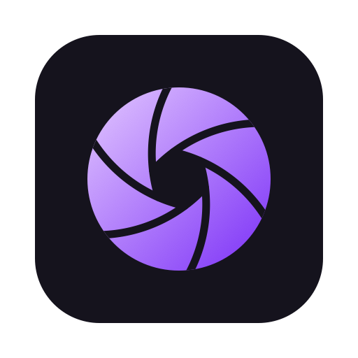

<p align="center">
  
</p>

<h1 align="center">Jilo Studio</h1>

<p align="center">
  <b>A non-linear video editor for the Mac, written in Rust.</b><br>
  An open-source fork of <a href="https://github.com/storytold/filmcraft">FilmCraft</a> by the ArtCraft team, focused on macOS and on AI tools for talking-head video in Russian, Tajik and English.
</p>

<p align="center">
  <a href="#license-and-credits"></a>
  
  
</p>

<p align="center">
  <a href="https://rustamguloff.com/en/page/projects/jilo-studio"><b>Website</b></a> ·
  <a href="https://github.com/guloff/jilo-studio/releases">Downloads</a> ·
  <a href="https://github.com/guloff/jilo-studio/issues">Issues</a> ·
  <a href="https://rustamguloff.com/ru/page/projects/jilo-studio">По-русски</a>
</p>

## What it is

Jilo Studio is FilmCraft, the clean-room, pure-Rust reimplementation of the Premiere Pro workflow,
built and tuned for the Mac, plus the AI features of the author's earlier editor, Jilo Studio Web.
Editing, trimming, multicam, colour, keyframes, effects, titles, captions, mixing, the codecs and
export come from FilmCraft; the [FilmCraft README](https://github.com/storytold/filmcraft#readme)
has the full tour.

**Status: early.** The first Jilo Studio release is being prepared; until then, build it from
source (below). Only Apple silicon Macs with macOS 15 Sequoia or later are supported.

## What this fork adds

- **Stability on macOS**: crash and data-loss fixes, auto-save and crash recovery checked on the
  Mac, framework symbols checked against the deployment target, a smoke test of every build.
- **Speed on the Mac**: VideoToolbox decoding and encoding (H.264, HEVC Main 10, hardware ProRes
  422 / 4444), GPU export, keys, masks and Track Matte on the GPU, Whisper and Kokoro on Metal.
- **The Mac way**: projects and media open from Finder and the Dock, the system's recent documents,
  HDR (EDR) in the monitors on XDR displays, a Russian interface.
- **AI tools** (in progress): speech recognition in Russian, Tajik and English with the time of
  every word; subtitle translation; highlights; automatic zooms; YouTube titles, chapters and tags;
  batch processing; pauses and filler words; framing on faces.

## AI and your privacy

- **Local first.** Speech recognition runs on your Mac (Whisper on Metal) by default; nothing is
  sent anywhere.
- **Cloud only when you ask.** Google Gemini and OpenAI are optional engines (Settings ▸ AI). Audio
  or text goes to them only when you run a feature with them, and the app says so before the first
  time.
- **Your keys stay yours.** API keys live in
  `~/Library/Application Support/com.rustamguloff.jilostudio/ai.json`, readable only by your user
  account (or come from `GEMINI_API_KEY` / `OPENAI_API_KEY`), never in projects or logs.
- **No telemetry.** Besides the AI providers you choose, the app only goes online to download the
  speech and voice models you ask for (from Hugging Face).

## Build from source

```sh
cargo run --release -p filmcraft                      # the app (the crates keep FilmCraft's names)
cargo run --release -p filmcraft -- --control 9876    # plus the JSON-lines control server
cargo run --release -p filmcraft-cli -- mcp           # MCP server (headless)
bash packaging/macos/package.sh                       # Jilo Studio.app and the DMG (ad-hoc signed)
```

The rules and quality gates are FilmCraft's: [docs/rules.md](docs/rules.md) and
[docs/contributing.md](docs/contributing.md); the architecture is in
[docs/architecture.md](docs/architecture.md), automation (MCP, control channel, CLI) in
[docs/automation.md](docs/automation.md).

## Relationship with FilmCraft

Jilo Studio follows [storytold/filmcraft](https://github.com/storytold/filmcraft): upstream changes
and pull requests that work on the Mac are merged in, one at a time, with their tests. The crates,
the `.fcproj` project format and the command set stay FilmCraft's, so projects open in both.
Jilo Studio is not made, sponsored or endorsed by the ArtCraft team, and its builds do not carry
the ArtCraft marks (their terms: [docs/brand/LICENSE-brand.txt](docs/brand/LICENSE-brand.txt)).

## License and credits

- **Code**: MIT OR Apache-2.0, at your option ([LICENSE-MIT](LICENSE-MIT),
  [LICENSE-APACHE](LICENSE-APACHE)), © the FilmCraft authors and Rustam Gulov; see [NOTICE](NOTICE).
- **FilmCraft** by the ArtCraft team and the FilmCraft contributors: the editor this fork is built on.
- **Assets**: every bundled file with its author, source and licence is in
  [ATTRIBUTION.md](ATTRIBUTION.md).
- **The Jilo Studio name and icon** belong to Rustam Gulov: free to use unmodified for Jilo Studio,
  not for other products ([assets/brand/jilo/LICENSE-brand.txt](assets/brand/jilo/LICENSE-brand.txt)).

Contact: [rustamguloff@gmail.com](mailto:rustamguloff@gmail.com).
